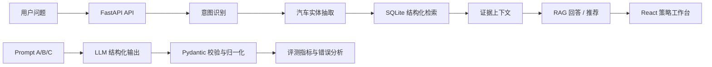

# AutoInsight

汽车垂类智能问答与大模型策略优化系统。

AutoInsight 面向汽车消费场景，串联意图识别、实体抽取、结构化知识检索、RAG 问答、可解释推荐、Prompt 策略实验和模型评测，重点展示 AI 应用开发、NLP 策略优化和大模型输出治理能力。

> 当前版本：Phase 6 已完成，包含可运行的 FastAPI 后端、React 前端、SQLite Demo 知识库、100 条评测样本和 A/B/C Prompt 实验框架。

## 项目亮点

- 七类汽车领域意图识别：购车推荐、车型对比、参数查询、价格查询、用户评价、用车知识、其他。
- 统一汽车实体 Schema：品牌、车型、预算、能源类型、车身类型、续航、使用场景、配置和关注属性。
- 规则 Baseline + OpenAI-compatible LLM 结构化抽取，支持 DeepSeek API。
- SQLite 结构化检索 + 证据约束回答，回答展示证据编号、来源、日期和数据状态。
- 硬约束过滤优先、软偏好加权排序的可解释推荐。
- A/B/C Prompt 策略对比：基础 Prompt、结构化 Prompt、Few-shot Prompt。
- 100 条独立汽车领域评测集，输出指标、混淆矩阵、延迟、Token 和错误案例。
- React 可视化工作台：智能问答、知识图谱、模型评测、错误分析和 Prompt 实验。
- 前端可配置 API Key，支持保存到本机 `.env`；密钥不会进入 Git。

## 系统架构



## 技术栈

| 层级 | 技术 |
| --- | --- |
| 后端 | Python 3.14.7、FastAPI、Pydantic、SQLite |
| NLP / 知识 | Pandas、NetworkX、规则抽取、结构化检索 |
| 大模型 | OpenAI Python SDK，兼容 DeepSeek API |
| 前端 | React、TypeScript、Vite、Tailwind CSS、Recharts |
| 测试 | pytest、httpx、TypeScript 构建检查 |
| 工程 | Git、REST API、JSON、CSV、dotenv |

## Windows 快速启动

### 1. 安装依赖

后端使用 Python 3.14.7。PowerShell 中执行：

```powershell
Set-Location H:\CodexProjects\AutoInsight
python -m pip install -r backend\requirements.txt
```

前端首次运行需要安装依赖：

```powershell
Set-Location H:\CodexProjects\AutoInsight\frontend
npm.cmd install
```

### 2. 一键启动

依赖安装完成后，双击项目根目录的：

```text
start_autoinsight.cmd
```

脚本会分别打开后端、前端终端，并尝试打开浏览器。它不依赖 PowerShell 虚拟环境激活策略。

### 3. 手动启动

终端一启动后端：

```powershell
Set-Location H:\CodexProjects\AutoInsight
python -m uvicorn backend.app.main:app --reload --host 127.0.0.1 --port 8000
```

终端二启动前端：

```powershell
Set-Location H:\CodexProjects\AutoInsight\frontend
npm.cmd run dev
```

访问：

- 前端：http://127.0.0.1:5173/
- Swagger：http://127.0.0.1:8000/docs
- 健康检查：http://127.0.0.1:8000/api/health

如果 5173 已被占用，Vite 会自动切换到其他端口，以终端实际输出为准。

## 配置模型 API

打开前端右上角的“设置”：

- API Key：填写 DeepSeek Key。
- Base URL：默认 `https://api.deepseek.com`。
- Model：默认 `deepseek-chat`。
- 勾选“记住配置到本机 `.env`”：后端重启后自动加载。

`.env` 已加入 `.gitignore`，不会提交到 Git。也可以手动复制配置模板：

```powershell
Copy-Item .env.example .env
```

没有 API Key 时，规则分析、SQLite 检索、Demo RAG 和离线评测仍然可以运行；真实 LLM Prompt 实验会显示 `not_run_no_key` 或不可用状态。

## 功能页面

### 智能问答

输入汽车问题后，可查看：

```text
用户问题 → 意图识别 → 实体抽取 → 结构化检索 → 证据约束回答
```

`Demo grounded` 不需要 API Key，使用 SQLite Demo 知识库检索并生成带来源的回答；`LLM grounded` 会把检索证据交给大模型生成回答。

### 知识图谱

使用 NetworkX 展示品牌、车型、版本、属性和观点关系，支持节点点击、属性查看、来源元数据和车型对比。

### 模型评测

读取 `reports/generated/` 中的真实评测结果，展示 Accuracy、Macro-F1、Entity F1、P95 延迟、按意图表现和 A/B/C 策略状态。

### 错误分析

查看规则误判、实体漏抽、Prompt 解析失败、Provider 错误等案例，支持按策略筛选。

### Prompt 实验

对同一个问题选择 A、B 或 C 策略，查看规则 Baseline、模型结构化输出、Prompt 版本、原始 JSON、响应延迟和 Token 使用量。

## RAG 实现说明

第一版没有引入向量数据库，而是使用 SQLite + 结构化过滤完成轻量 RAG：

1. 规则或 LLM 识别用户意图。
2. 抽取预算、能源类型、车身类型、续航和使用场景。
3. 先执行预算、能源、车身、续航等硬约束过滤。
4. 从汽车知识库生成结构化证据。
5. Demo 模式使用证据模板回答；LLM 模式把证据放入上下文。
6. 校验模型引用只能来自已检索证据，无法验证时明确拒答。

## Prompt 策略

| 策略 | 设计 | 适用目的 |
| --- | --- | --- |
| A | 基础 Prompt | 最小约束 Baseline，观察格式漂移和基础能力 |
| B | 明确标签、字段类型和 JSON Schema | 提升结构化输出稳定性 |
| C | B + 典型、口语化、否定和缺失信息示例 | 测试 Few-shot 对边界问题的影响 |

C 不一定优于 A 或 B。项目通过同一测试集、固定模型和参数记录实际结果，不预设效果结论。

## 数据与来源边界

- `data/demo/cars.json` 是明确标记为 Demo 的人工构造数据，不代表真实市场报价或官方参数。
- 评测集位于 `data/evaluation/intent_entity_eval.json`，与 Few-shot 示例分离。
- 项目不实现未经授权的网站爬虫。
- 每条 Demo 事实保留来源名称、来源类型、采集日期和数据状态字段。
- SQLite 数据库、生成报告、虚拟环境、前端依赖和 `.env` 均为本地运行产物，不提交到 Git。

## 评测与测试

运行规则 Baseline 和报告生成：

```powershell
Set-Location H:\CodexProjects\AutoInsight
python scripts\run_evaluation.py
```

报告输出到 `reports/generated/`：

- `evaluation_report.md`
- `evaluation_results.json`
- `rule_baseline_records.csv`
- `error_cases.json`
- 配置真实 API Key 后额外生成 `prompt_strategy_records.csv`

评测指标包括：

- 意图识别 Accuracy、Macro-F1、混淆矩阵
- 实体 Precision、Recall、F1
- 平均延迟、P95 延迟、输入/输出 Token
- Prompt 解析失败、Provider 错误和错误样本

运行测试：

```powershell
python -m pytest backend\tests -q
```

前端构建：

```powershell
Set-Location H:\CodexProjects\AutoInsight\frontend
npm.cmd run build
```

最近一次已验证记录：

```text
后端 NLP + Evaluation 相关测试：12 passed
前端生产构建：成功
```

本地规则 Baseline 报告曾在 100 条样本上得到 Accuracy 0.86、Macro-F1 0.862609、Entity F1 0.727273，并记录 14 个错误案例。A/B/C 真实模型指标只有在配置 API Key 并实际运行评测后才会产生，不能用规则结果替代。

## 项目结构

```text
AutoInsight/
├── backend/
│   ├── app/
│   │   ├── core/              # SQLite 初始化
│   │   ├── evaluation/        # Prompt 评测与指标
│   │   ├── schemas/           # Pydantic 数据结构
│   │   ├── services/          # NLP、检索、RAG、推荐和 LLM
│   │   └── main.py            # FastAPI 入口
│   ├── tests/                 # 后端测试
│   └── requirements.txt
├── frontend/
│   └── src/                   # React 工作台
├── data/
│   ├── demo/                  # 明确标记的 Demo 数据
│   └── evaluation/            # 独立评测集
├── prompts/                  # A/B/C Prompt 和 Few-shot 示例
├── scripts/                  # 评测脚本
├── start_autoinsight.cmd     # Windows 一键启动
├── .env.example
└── README.md
```

## 简历项目描述

**AutoInsight｜汽车垂类智能问答与大模型策略优化系统**

基于 FastAPI、React、SQLite 和 OpenAI-compatible SDK 搭建汽车消费场景 AI 应用，完成意图识别、实体抽取、结构化知识检索、证据约束 RAG、可解释推荐和 A/B/C Prompt 策略实验；构建 100 条领域评测集，输出 Accuracy、Macro-F1、实体 F1、延迟、Token 和错误案例，并通过前端工作台展示模型分析链路。

## 后续计划

- 接入经过授权的真实汽车资料并完善来源审核。
- 增加文本片段切分和向量检索，与结构化过滤组成混合 RAG。
- 继续完善 LLM 评测、成本估算和多轮对话记忆。
- 增加更多真实模型调用记录后，再比较 A/B/C 的实际收益。
